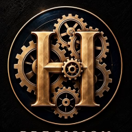

<p align="center">
  &nbsp;&nbsp;
  &nbsp;&nbsp;
  &nbsp;&nbsp;
  
</p>

<h1 align="center">LifeOS</h1>

<p align="center">
  Gündelik hayat için üç bağımsız sistem: <b>sınav</b>, <b>sağlık</b>, <b>gelişim</b>.<br/>
  Tarayıcıda ve telefonda çalışır; hesabın ve verin senin bilgisayarında durur.
</p>

## LifeOS nedir?

LifeOS, tek bir kişinin gündelik hayatını yöneten bir sistemler bütünüdür.
Üç ayrı uygulamadan ve onların yanında duran isteğe bağlı bir merkezden
oluşur:

- **AYS** sınava hazırlığı yönetir: ders konuları, haftalık plan, denemeler,
  hata analizi, tekrar kartları ve konuları uygulamanın içinde öğrenme.
- **SPİ** sağlığı izler: uyku, beslenme, hareket, tahliller ve bunların bedeli.
- **ESP** kişisel gelişimi planlar: dil, felsefe, müzik ve diksiyon, okuma,
  yazı ve tarih.
- **HKM** üçünün yanında durur: günün özetini çıkarır, sistemler arasındaki
  bağlantıları gösterir, sohbet eder. Kapalıyken üç sistem aynen çalışır.

Her sistem kendi başına açılır, kendi verisini tutar ve diğerlerini bozamaz.
Hepsinin ortak bir kuralı vardır: **sayıyı ve kararı kod üretir; yapay zekâ
yalnız açıklar.** Model kapalıyken de bütün sistem çalışır.

## Başlarken

| | Ne yapılır |
|---|---|
| **Aç** | `BASLAT.bat` dosyasına çift tıkla. Tarayıcıda **kontrol paneli** açılır: <http://127.0.0.1:4180> |
| **Güncelle** | Kontrol panelindeki **Güncelle** düğmesi ya da `GUNCELLE.bat` |
| **HKM** | Kontrol panelinde HKM kartındaki **Başlat**; anahtar sorulmadan bağlanır |
| **Durdur** | `python sistem/baslat.py --dur` |

Gereken tek şey [Python 3](https://www.python.org/downloads/). macOS ve
Linux'ta: `sistem/BASLAT.command` · `sistem/baslat.sh`.

Güncelleme yalnız ileri sarar: elle değiştirilmiş bir dosya varsa hiçbir
şeye dokunmaz ve nedenini söyler. Zip ile indirilmiş bir klasörü ilk
güncellemede GitHub'a bağlar. Verin git'in dışındadır; güncelleme ona
dokunmaz.

## Dört parça

| | Sistem | Ne yapar | Adres |
|---|---|---|---|
|  | **AYS** — Akademik Yol Sistemi | Sınav hazırlığı: plan, konu öğrenme, deneme, tekrar | `:4173` |
|  | **SPİ** — Sağlık Performans İzleyicisi | Uyku, beslenme, hareket, tahlil, sağlık bütçesi | `:4183` |
|  | **ESP** — Entelektüel Seviye Planlayıcı | Dil, felsefe, müzik, diksiyon, okuma, yazı, tarih | `:4193` |
|  | **HKM** — Hayat Kontrol Merkezi | İsteğe bağlı merkez: günün özeti, çapraz bulgu, sohbet | `:4200` |

Üç sistem birbirini bilmez ve birbirini bozamaz. HKM üçünün **yanında**
durur, üstünde değil: kapalıyken, yavaşken ya da hata verirken hiçbiri
bozulmaz, yavaşlamaz, veri kaybetmez.

---

## AYS — Akademik Yol Sistemi

YKS'ye (TYT ve AYT) hazırlanan bir öğrencinin bütün çalışma düzeni. Sol
kenardaki çekmeceler günün işine göre sıralanır:

| Çekmece | Ekranlar | Ne işe yarar |
|---|---|---|
| **Bugün** | Genel bakış | Günün planı, sıradaki iş ve günün kaydı tek sayfada |
| **Plan** | Hafta · Program · Hedefler | Haftalık plan, bütün programın zaman çizgisi, hedef netler ve hedefe giden plan |
| **Çalışma** | Konu çalış · Soru çöz · Deneme · Tekrar · Sınama | Konu takibi, fotoğraftan soru çözdürme, deneme kaydı ve analizi, aralıklı tekrar kartları, öz değerlendirme |
| **Öğren** | Konular · Anlatım · Sorular · Koç · Ders notları | Konuları uygulamanın içinde öğrenme (aşağıda) |
| **Analiz** | İlerleme · Ayrıntı · Telafi | Net gidişatı, hata haritası, yayın farkı; geride kalındığında durum tespiti ve telafi protokolü |
| **Onaylar** | Bekleyen | Koçların önerdiği değişiklikler; onaylanınca kod uygular |
| **Ofis** | Masalar · Danışma · Toplantı | Altı ajanlı çalışma ekibi: her biri kendi alanına bakar, toplantıda birlikte karar önerir |
| **Kütüphanem** | Kitaplar | Kendi kaynakların, test kitapların ve BAM'ın ürettikleri |
| **Ayarlar** | Genel · Profil · Rütbe | Görünüm, profil, veri, yedek ve seviye |

**Öğren bölümü.** Sekiz dersin (TYT Türkçe, Matematik, Fen, Sosyal; AYT
Matematik, Fizik, Kimya, Biyoloji) bütün konuları için uygulamanın içinde
yazılmış bir anlatım ve ÖSYM biçiminde sorular vardır. Her konunun ikinci
katında kazanımlar, ön koşul konular, önce kendin dene diye çözümü kapalı
gelen örnekler, «sınavda nasıl sorulur» kalıpları, sık yapılan hatalar ve
ipuçlu orta–ileri sorular bulunur. Sorular gerektiğinde **şekil ve tablo**
içerir (devre, grafik, soyağacı, koordinat düzlemi, iklim grafiği…); şekiller
temaya uyar ve ekran okuyucu için yazılı açıklamaları vardır. Ayrıca:

- **Karma test ve Yanlışlarım:** seçtiğin derslerden karışık test; yanlış
  yaptığın sorular ayrı bir listede toplanır.
- **Günlük paragraf:** her gün 3, 5 ya da 10 soruluk paragraf seti; bitince
  günün kaydına bir kez yazılır, geri alınabilir.
- **Çıkmış sorular künyesi:** bir konuya hangi yılın hangi sorusunun
  düştüğünü (sınav, yıl, soru numarası, resmî kitapçık bağlantısı) yazarsın.
  ÖSYM'nin soru metinleri kopyalanmaz.
- **Konuya video ve not**, **Hata bildir** (yanlış bulduğun soru testlere
  girmez) ve konunun öğrenme yolu: öğren → kartla → soru çöz → yanlışları
  kapat → konu testi.

İçerik elle yazılmıştır ve ekranda «doğrulanmadı» diye işaretlidir; bir
soru düzeltilirse eski cevapların o soruyu etkilemez.

**Deneme.** Deneme sonuçları test test girilir; net kodla hesaplanır
(doğru − yanlış/4). Sonuç kâğıdının fotoğrafından doğru, yanlış ve boş
okunabilir; okunan sayıları kod doğrular, kaydetmek senin onayındır.
Süreli oturum sınav koşullarını taklit eder ve soru başına süreyi ölçer. Her
yanlış ve boş için konu, etiket ve kök neden yazılır; her hata kaydı bir
tekrar kartı açar. Yayın merdiveni, yayınlar arasındaki zorluk farkını
hesaba katar.

**Deneme soru analizi.** Cevap anahtarını ve kendi cevaplarını yazarsan
(harfler yan yana ya da yayının sayfasından «1-A 2-C …» diye yapıştırarak)
sorular tek tek karşılaştırılır; kayıttaki sayılarla fark varsa gösterilir,
kayıt kendiliğinden değişmez. Yanlış ve boş soruların fotoğrafını kendi
kitapçığından çekersin; fotoğraf cihazında kalır. «Çöz» deyince model soruyu
**anahtarı görmeden** çözer, verdiği şıkkı anahtarla kod karşılaştırır ve
tutmayan çözüm uyarıyla gösterilir. Sorunun konusu kapalı katalogdan
«tahmin» etiketiyle gelir, elle düzeltebilirsin; tek dokunuşla hata kaydı ve
tekrar kartı açılır, konu Öğren'de açılır. **Yayın karnesi** her yayında en
çok kaçırdığın konuları ve bunların öteki yayınların denemelerine göre payını
gösterir; karneye yalnız denemeye bağlı hatalar girer (Öğren, çıkmış soru ve
test kitabı hataları karışmaz).

**Ofis ve koç.** Ajanlar ücretsiz dil modeli uçlarına (kendi anahtarınla)
bağlanabilir; model yokken de sohbet edilir. Ajanlar sayı uydurmaz: her sayı
kural motorundan gelir ve kesinlik etiketi taşır.

## SPİ — Sağlık Performans İzleyicisi

Sağlığı ölçen, ölçüme göre öneren ve bunun bedelini hesaplayan sistem.
Çekmeceler:

| Çekmece | Ekranlar | Ne yapar |
|---|---|---|
| **Bugün** | Genel bakış | Günün verisi girilir (uyku, öğün, hareket, ruh hâli); karşılığı aynı sayfada görünür |
| **Plan** | Hedefler | Sağlık hedefleri ve hedefe giden plan |
| **Çalışma** | Testler · Öğün · Mutfak · Hareket · Bütçe | Hastane testi tek seferde girilir; bazal metabolizma, hedef ve tahlile bağlı öğün önerisi; kardiyo, kuvvet, esneklik ve dinlenme ayrı alanlar (telefonda rota haritası ve canlı kayıt); koç önerilerinden çıkan sağlık bütçesi |
| **Analiz** | Analiz | Ölçümlerin gidişatı ve kararın dayanağı |
| **Onaylar** | Bekleyen | Koçların önerdiği değişiklikler; onaylanınca kod uygular |
| **Ofis** | Masalar · Danışma · Toplantı | Patron ve dört koç: birbirleriyle konuşur, çelişkiyi patron çözer |
| **Kütüphanem** | Bilgi ve ürünler | BAM'ın ürettikleri |
| **Ayarlar** | Profil · Genel · Rütbe | Hane, profil, görünüm, veri, sınırlar |

Kayıtlara küçük fotoğraflar eklenebilir; fotoğraflar çekildiği cihazda
kalır. **SPİ teşhis koymaz ve ilaç dozu önermez**; eşiklerin nereden geldiği
kanıt katmanında yazılıdır.

## ESP — Entelektüel Seviye Planlayıcı

Kişisel gelişimi disiplin disiplin planlayan sistem. Çekmeceler:

| Çekmece | Ekranlar | Ne yapar |
|---|---|---|
| **Bugün** | Genel bakış | Günün pratiği girilir, karşılığı görünür |
| **Plan** | Merdiven | Her disiplinde bir sonraki basamak, seviye tespiti |
| **Çalışma** | Dil · Felsefe · Tarih · Ses · Okuma · Yazı | Dil Stüdyosu (aralıklı tekrar, dilbilgisi), Sempozyum (sorular, metinler, düşünce deneyleri), Kronoloji (zaman şeridi), Stüdyo (müzik, diksiyon, kulak eğitimi), Kütüphane (notlar, okuma matrisi), Yazı Laboratuvarı (taslak, ölçüm) |
| **Analiz** | Analiz | Kararın dayanağı |
| **Onaylar** | Bekleyen | Bekleyen öneriler |
| **Ofis** | Masalar · Danışma · Toplantı | Patron, yedi uzman ve bir koç (dokuz ajan) |
| **Kütüphanem** | Kütüphanem | BAM'ın ürettikleri |
| **Ayarlar** | Profil · Genel · Rütbe | Profil, görünüm, veri ve rehber |

Her disiplinin altında bir tezgâh durur: koç (yazılı ve sesli), harita,
ekler, hatırlatma ve plan. Sistem kendini de denetler: kalibrasyon defteri
tahminlerinin ne kadar tuttuğunu ölçer, «Goodhart nöbetçisi» ölçünün amaca
dönüşmesine karşı uyarır. **ESP sertifika vermez, yetenek yargısı kurmaz,
sonuç garantisi etmez.**

## HKM — Hayat Kontrol Merkezi

Üç sistemin yanında duran, isteğe bağlı bir Python servisi (yalnız standart
kütüphane). Kendi yüzü ve veritabanı vardır.

- **Günün özeti:** üç sistemden gelen birkaç sayı, her biri kesinlik
  etiketiyle; içerik gönderilmez.
- **Çapraz bulgu:** hiçbir sistemin tek başına göremeyeceği bağlantılar (ör.
  uyku saati ile ertesi günün çözülen soru sayısı).
- **Sohbet:** üst patron «King» ile konuşma; her modülden Ctrl'e iki kez basınca açılır, yazarak ya da mikrofonla konuşulur, sesle sorulana cihazdaki Türkçe sesle cevap verir.
- **Niyet kuyruğu:** HKM hiçbir modüle doğrudan yazmaz; teklif yazar, modül
  kendi koduyla uygular ya da reddeder.
- **Yedek:** bağlıysa her modülün verisinin günde bir yedeği.
- **BAM:** HKM'nin alt modülü; ayrı bir sistem değildir.

Modüllerle bağ, her arayüzdeki işaret (`core/beacon.js`) üzerinden kurulur
ve **varsayılan olarak kapalıdır**.

---

## Ortak katmanlar

### Hesap ve eşitleme

PC, telefon ve tablet aynı hesapla girer. Kayıtların kopyası **senin
bilgisayarındaki** LifeOS sunucusunda durur (`sistem/hesap.py`); veri hiçbir
şirketin sunucusuna gitmez.

- Sunucu kapalıyken hiçbir modül bozulmaz ya da yavaşlamaz; değişiklik
  cihazda sıraya girer, bağlanınca akar.
- Kayıt düzeyinde son yazan kazanır; bir cihazın ilk eşitlemesi sunucudakini
  ezmez. Fotoğraflar eşitlenmez.
- İlk hesap (admin) yalnız bilgisayarın kendisinden kurulur; parola düz
  tutulmaz. İki adımlı doğrulama (TOTP, yedek kodlar), kodla cihaz bağlama,
  cihaz listesi ve kurtarma sorusu vardır.
- **Gelen kutusu:** erişim anahtarıyla iPhone Kısayollar ya da Home
  Assistant'tan satır gönderilir; satırı yalnız ilgili modül alır ve Onaylar'a
  öneri yapar. Ölçüm onaysız yazılmaz.
- **Takvim aboneliği** (AYS ve ESP), hesap deposunun **günlük yedeği** ve
  Siri'ye «Bugün ne var?» diye sorulabilen gün özeti.

### Telefon uygulaması

Ekran kapalıyken de rota kaydı yapılabilsin diye iPhone için yerel bir kabuk
vardır (`uygulama/`, Swift, üçüncü taraf paket yok). Üç arayüzün derlenmiş
hâllerini içine alır ve telefonda yerel bir sunucuyla açar; kurulumu
AltStore ile ücretsizdir. Ayrıntı: [`belgeler/UYGULAMA.md`](belgeler/UYGULAMA.md).

### Dil modeli

Koçlar ve ajanlar, kendi anahtarınla bağladığın ücretsiz uçlarla (OpenRouter,
Groq, Google AI Studio, yerel uçlar) konuşur. Anahtarlar uygulama verisinden
ayrı durur, yedeğe ve buluta gitmez. Görüntü okuyabilen bir model bağlıysa
fotoğraftaki soru çözülebilir ve sonuç kâğıdı okunabilir; okunan her şeyi
kod doğrular.

### Seviye, rütbe ve rozet

Üç sistemin her birinin **kendi** seviyesi vardır ve kendi işiyle dolar: AYS'de
soru çözerek, SPİ'de antrenman kaydederek, ESP'de pratik yaparak. Altı kademe
vardır (Bronz · Gümüş · Altın · Yakut · Safir · Kutsal); tanımı tek kaynaktan
(`brand/seviye/`) dağıtılır. Rozetler ayrı şeyler ölçer. **XP hiçbir kararı
etkilemez**: plan, reçete, uyarı ya da öneri ona bakmaz; yalnız görünürlüktür.

### Tasarım

Üç arayüz aynı tasarım dilini kullanır: aynı kart, düğme ve tablo
bileşenleri, tek renk paleti (kâğıt), açık ve koyu tema. Telefon (390 piksel) ve
tablet düzeni, dokunma hedeflerinin boyu ve bütün paletlerde metin kontrastı
denetim araçlarıyla ölçülür.

---

## Kararlar nasıl verilir?

- **Sayıyı kod üretir.** Net, uyku ortalaması, sıralama tahmini gibi ölçülmüş
  ya da hesaplanmış bir sayıyı hiçbir ajan değiştiremez. Dil modeli yalnız
  cümleye çevirir.
- **Eksik veri sıfır değildir.** Her sayı etiketlidir: ölçüldü · tahmin ·
  hesaplandı · veri yok.
- **Anlaşılmayan tahmin edilmez.** Belirsiz girdi sorulur; ölçülmemiş bir
  şey «temiz» diye gösterilmez.
- **Değişikliğin üç boyu vardır.** *Küçük* (tek gün, tek kayıt) sormadan
  uygulanır ve «Geri al» kalır; *orta* (bir hafta, bir dönem) önizleme ve tek
  onay ister; *büyük* (sınav değiştirmek, planı baştan kurmak) ayrıntılı
  önizleme, onay ve geri dönüş noktası ister. Hangi küçük değişikliklerin
  sormadan uygulanacağını sen ayarlarsın.
- **Sınırlar açık.** SPİ teşhis koymaz, doz önermez; AYS ve ESP sertifika
  vermez, sonuç garantisi etmez.

## Verin

- Her sistemin verisi önce kendi tarayıcı deposunda durur.
- Hesap açıksa kopyası bilgisayarındaki hesap deposunda
  (`%LOCALAPPDATA%\LifeOS\hesap\`), HKM'ninki `HKM/db/` altında durur.
- Hiçbiri git deposuna girmez; güncelleme verine dokunmaz.
- Yedek almak için her sistemin ayarlarında (AYS'de **Genel**, SPİ'de
  **Genel**, ESP'de **Profil**): «Yedek al» · «Yedekten yükle». Hesap sayfasından bilgisayardaki kopyanın tamamı tek
  dosya olarak indirilebilir.

## Klasör düzeni

```text
LifeOS/
├── BASLAT.bat        aç
├── GUNCELLE.bat      güncelle
├── AYS/  SPI/  ESP/  üç sistem — her biri tek başına çalışır
├── HKM/              isteğe bağlı merkez (Python servisi)
├── uygulama/         iPhone kabuğu (Swift)
├── sistem/           başlatıcı, tek sunucu, hesap, güncelleyici
├── brand/            ortak tasarım, görseller, seviye sistemi (tek kaynak)
├── tools/            depo denetim araçları
├── belgeler/         teknik belge, raporlar, ekip notları
├── README.md         bu sayfa
└── AGENTS.md         kodlama ajanları için kurallar
```

## Geliştirme

- **Bağımlılık yok.** Üç arayüzde çerçeve, paket ya da derleyici yoktur;
  tarayıcıda düz JavaScript çalışır. HKM yalnız Python standart kütüphanesini
  kullanır. Playwright yalnız denetim betikleri içindir.
- **Her sistemin kendi testleri ve denetimleri vardır:** birim testleri,
  uygulamayı gerçekten açıp ekranları gezen duman testi, erişilebilirlik,
  telefon ve tablet düzeni, palet kontrastı, çizim bütçesi ve beş yıllık
  veriyle yük denetimi. `node tools/entegre.js` üç arayüzü ve HKM'yi uçtan
  uca dener; HKM kapalıyken hiçbir arayüzün bozulmadığını da gösterir.
- **Ortak olanlar tek kaynaktan yayılır** (`brand/ortak/`, `brand/seviye/`);
  kopyaların kaynakla aynı olduğunu denetimler ve CI sınar.
- Test ve denetim sayıları elle yazılmaz; aşağıdaki bölümü
  `tools/sayilar.py` üretir.
- Kodlama ajanlarının uyduğu kurallar ve denetim komutları: [`AGENTS.md`](AGENTS.md).

## Daha fazlası

| | |
|---|---|
| Teknik ayrıntı (çalıştırma, telefon, sınırlar) | [`belgeler/TEKNIK.md`](belgeler/TEKNIK.md) |
| Sistem mimarileri | [AYS](AYS/src/OFIS.md) · [SPİ](SPI/src/MIMARI.md) · [ESP](ESP/src/MIMARI.md) · [HKM](HKM/MIMARI.md) |
| Telefon uygulaması | [`belgeler/UYGULAMA.md`](belgeler/UYGULAMA.md) |
| Geliştirme raporu ve notlar | [`belgeler/`](belgeler/) |
| Denetimler ve katkı kuralları | [`AGENTS.md`](AGENTS.md) §2 |

## Ölçülmüş sayılar

<details>
<summary>Test ve denetim sonuçları — elle yazılmaz, <code>python3 tools/sayilar.py --tam --yaz</code> üretir</summary>

<!-- SAYILAR:baslangic -->

_Bu bölüm elle yazılmaz: `python3 tools/sayilar.py --yaz` araçları koşturur ve her aracın kendi son satırını buraya yazar. Son koşum: 2026-10-23._

| Araç | AYS | SPI | ESP |
|---|---|---|---|
| `runtests.js` | 2911/2911 gecti | 2576/2576 gecti | 2390/2390 gecti |
| `smoke.js` | Duman testi temiz — 2 hedefte 54 ekran, 10 sekme gezildi. | Duman testi temiz — 2 hedefte 38 ekran, 0 sekme gezildi. | Duman testi temiz — 2 hedefte 38 ekran, 0 sekme gezildi. |
| `a11ycheck.js` | erisilebilirlik temiz (1 bilinen eksik izin listesinde) | erisilebilirlik temiz (1 bilinen eksik izin listesinde) | erisilebilirlik temiz (3 bilinen eksik izin listesinde) |
| `palettecheck.js` | 110 kontrast ölçümü AA geçti — en dar pay: metin merdiveni sırası 1.03 (asgari 1) — light/kagit/today | 146 kontrast olcumu AA gecti — en dar pay: metin merdiveni sırası 1.03 (asgari 1) — light/kagit/today | 164 kontrast ölçümü AA geçti — en dar pay: metin merdiveni sırası 1.03 (asgari 1) — light/kagit/today |
| `layoutcheck.js` | Telefon ve tablet düzeni temiz — 390 ve 820 pikselde 64 yerde taşma yok, bütün dokunma hedefleri 24px ve üstü. | Telefon ve tablet düzeni temiz — 390 ve 820 pikselde 90 yerde taşma yok, bütün dokunma hedefleri 24px ve üstü. | Telefon ve tablet düzeni temiz — 390 ve 820 pikselde 38 yerde taşma yok, bütün dokunma hedefleri 24px ve üstü. |
| `perfcheck.js` | Bütün ekranlar bütçede — en ağırı office 22.8 ms (bütçe 120). | Bütün ekranlar bütçede — en ağırı today 30.5 ms (bütçe 100). | Bütün ekranlar bütçede — en ağırı office 83.4 ms (bütçe 100). |
| `ledgercheck.js` | — | 32 ekran/sekmede defter düzeni temiz | — |
| `designcheck.js` | — | 1 düzen temiz — 116 ekran/genişlik kombinasyonu bakıldı | — |
| `tasarimcheck.js` | — | 21 tasarım örneği temiz | — |
| `loadcheck.js` | yuk denetimi temiz (5 yillik veri) | yuk denetimi temiz (5 yillik veri) | yuk denetimi temiz (5 yillik veri) |

| Depo denetimi | Sonuç |
|---|---|
| `HKM tests` | 965/965 test gecti |
| `HKM perf` | Bütün sorgular bütçede. |
| `HKM yuz` | HKM yüzü temiz — 52 görünümde taşma yok, bütün hedefler 24px ve üstü, etiketler yerinde, kontrast AA. |
| `marka.py` | marka adlandirma ve yol muhafizi temiz (25 durum) |
| `marka kunyesi` | Medya kunyesi taze (43 gorsel, 4 aile). |
| `seviye.py` | Seviye sistemi: uc arayuzde de kaynakla ayni. |
| `ortak.py` | Ortak kaynak: kopyalar kaynakla ayni (149 dosya, 447 kopya). |
| `entegre.js` | Butunlesme temiz: uc arayuz de HKM ile konustu, HKM kapaliyken hicbiri bozulmadi. |
<!-- SAYILAR:bitis -->

</details>
